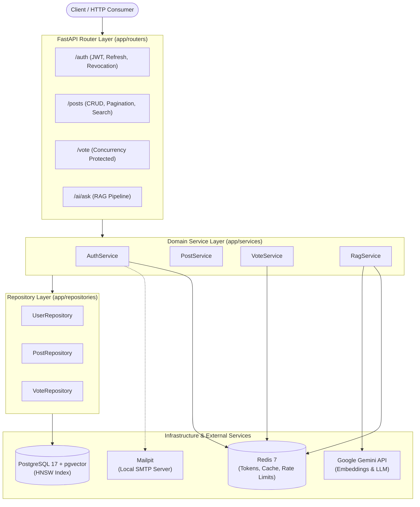

# Pulse Core API

An asynchronous, production-oriented REST API built with FastAPI, PostgreSQL (`pgvector`), Redis, and Google Gemini. 

The project focuses on solving practical backend engineering problems: asynchronous I/O, semantic search with RAG, database concurrency control, refresh token lifecycle security, and multi-layer caching.

---

## 1. Key Engineering Highlights

* **Pessimistic Row-Level Locking:** Uses `SELECT ... FOR UPDATE` via SQLAlchemy `with_for_update()` to serialize concurrent vote updates and eliminate race conditions at the database level.
* **Token Rotation & Theft Detection:** Stateless access tokens (15m) paired with rotating refresh tokens (7d). Storing used token JTIs with automatic session invalidation upon reuse attempts.
* **Semantic Vector Retrieval & Caching:** Vector similarity search using PostgreSQL `pgvector` HNSW index combined with a Redis hash-based caching layer for repeated queries.
* **Decoupled Architecture:** Strict separation between HTTP routers, domain services, and data access repositories (Repository Pattern).
* **Fault-Isolated Test Suite:** 42 unit and integration tests executing against an isolated PostgreSQL instance with mocked external AI providers.

---

## 2. Tech Stack

* **Language & Runtime:** Python 3.13, AsyncIO
* **Web Framework:** FastAPI, Pydantic v2
* **Database & ORM:** PostgreSQL 17 + `pgvector`, SQLAlchemy 2.0 (Async), Alembic
* **Vector Index:** HNSW (`vector_cosine_ops`, `m=16`, `ef_construction=64`)
* **Caching & Rate Limiting:** Redis 7, `slowapi`
* **AI Provider:** Google Gemini API (`gemini-embedding-001`, `gemini-2.5-flash-lite`)
* **Background Tasks & Testing Mailer:** FastAPI `BackgroundTasks`, Mailpit
* **Testing:** Pytest, `pytest-asyncio`, `unittest.mock`
* **Containerization:** Docker, Docker Compose

---

## 3. System Architecture



---

## 4. Key Features

### Vector Retrieval & Semantic Search
* Generates 768-dimensional text embeddings on post creation via `gemini-embedding-001`.
* Cosine distance querying via pgvector with distance threshold filtering (`distance < 0.45`).
* Structured responses validated via Pydantic schemas (context sufficiency flag, source post citations, and response explanation).

### Concurrency & Integrity
* Atomic vote mutation handling: database row-level locking ensures that concurrent delete operations do not result in lost updates or corrupted counter states.
* Composite primary key constraints (`post_id`, `user_id`) in PostgreSQL prevent duplicate records; violations are handled with transactional rollback and translated to `409 Conflict`.

### Authentication & Token Security
* Dual-token system: short-lived access tokens (15m) and single-use refresh tokens (7d).
* JTI (JWT ID) tracking in Redis prevents replay attacks.
* Role-Based Access Control (RBAC) dependency verification (`admin`, `user`).

### Rate Limiting & Throttling
* IP-based rate limiting via `slowapi` and Redis backend to mitigate brute-force and scraping attempts on sensitive endpoints.

---

## 5. Engineering Decisions & Trade-offs

| Problem | Selected Approach | Alternative Considered | Why Chosen? / Trade-offs |
| :--- | :--- | :--- | :--- |
| **Duplicate Voting** | Composite Primary Key (`post_id`, `user_id`) | Application-level `SELECT` check only | Avoids race conditions during simultaneous `INSERT` requests; database guarantees uniqueness. |
| **Concurrent Votes Modification** | Pessimistic Row Locking (`SELECT ... FOR UPDATE`) | Optimistic Locking with version column | Pessimistic locking prevents conflicting deletes from issuing invalid Redis counter decrements. Trade-off: brief row-level lock duration during transaction. |
| **Repeated RAG Queries** | Exact Match Cache via SHA-256 hash in Redis | Semantic vector cache for questions | Exact hashing provides sub-millisecond lookups with zero embedding API cost. Trade-off: minor wording variations produce cache misses. |
| **Vector Indexing** | HNSW (`m=16`, `ef_construction=64`) | IVFFlat | HNSW provides superior recall and search throughput without requiring table training phases, at the cost of higher index memory usage. |
| **Background Notifications** | FastAPI `BackgroundTasks` | Celery / RabbitMQ | Sufficient for lightweight email dispatch without additional worker daemon overhead. Trade-off: in-memory queue; unhandled crashes may drop pending tasks. |
| **Data Access Decoupling** | Repository Pattern | Direct ORM queries in Services | Isolates SQLAlchemy expressions and vector queries, enabling clean unit testing with mocked data layers. |

---

## 6. Performance & Benchmarking

> [!NOTE]
> Formal load test measurements across varying concurrency levels (100–1000 VU) using k6 / Locust are scheduled for the deployment milestone. Target metrics tracked:

| Metric | Target | Observed (Local) | Notes |
| :--- | :--- | :--- | :--- |
| **RAG Cache Hit Latency** | < 5 ms | ~1-2 ms | Direct Redis `GET` + Pydantic deserialization |
| **RAG Cache Miss Latency** | < 2000 ms | ~1200-1800 ms | Embedding + pgvector HNSW + Gemini LLM roundtrip |
| **Vote Endpoint p95** | < 20 ms | Pending load test | Protected by row-level lock |
| **Token Verification p99** | < 2 ms | ~0.5 ms | In-memory cryptographic signature check |

---

## 7. Security Considerations

### Refresh Token Theft Detection Mechanism
1. Upon successful login or refresh, a new token pair is issued. Both tokens share unique cryptographically secure `jti` identifiers.
2. When `/auth/refresh` is called:
   * The incoming refresh token's `jti` is verified against Redis.
   * If the `jti` was already marked as consumed (`used_refresh:{jti}`):
     * **Theft Detected:** An adversary is attempting to replay a previously rotated token.
     * **Immediate Mitigation:** The user's account active sessions are revoked by writing `user:{id}:revoked_at = now()` to Redis.
     * All existing tokens issued prior to this timestamp are rejected immediately by authentication dependencies.
   * If valid: the old token's `jti` is blacklisted in Redis with a TTL matching its expiry, and a new token pair is issued.

---

## 8. Testing Strategy

The test suite contains 42 automated tests covering business logic, security constraints, and database edge cases:

* **Concurrency & Race Conditions:** `tests/test_votes.py` executes concurrent vote requests via `asyncio.gather` to verify that simultaneous operations resolve deterministically into `{201, 409}` status codes without data corruption.
* **Authentication & Theft Detection:** `tests/test_users.py` validates normal token rotation, reuse attempts triggering session revocation, and cross-type token attacks (attempting to use refresh tokens as bearer authorization).
* **AI & Caching Isolation:** `tests/test_ai.py` mocks Google Gemini API via `unittest.mock.AsyncMock`, verifying both cache-miss upstream calls and cache-hit Redis returns (`mock.call_count == 1`).
* **Test Isolation:** Every test runs against a dedicated test database (`pulse_db_test`) using SQLAlchemy `NullPool` to prevent leaked connection states between fixtures.

---

## 9. Project Structure

```text
├── app/
│   ├── config.py              # Environment configuration (Pydantic BaseSettings)
│   ├── database.py            # Async engine and session factory
│   ├── models.py              # SQLAlchemy declarative models & pgvector indexes
│   ├── schemas.py             # Pydantic v2 validation models
│   ├── oauth2.py              # JWT generation, token inspection & dependencies
│   ├── limiter.py             # Slowapi rate limiter instance
│   ├── errors.py              # Centralized domain exception hierarchy
│   ├── repositories/          # Data Access Layer (Repository Pattern)
│   │   ├── post_repository.py
│   │   ├── user_repository.py
│   │   └── vote_repository.py
│   ├── services/              # Business Logic Layer
│   │   ├── auth_service.py
│   │   ├── post_service.py
│   │   ├── vote_service.py
│   │   ├── rag_service.py
│   │   └── email_service.py
│   └── routers/               # FastAPI Endpoint Definitions
│       ├── auth.py
│       ├── post.py
│       ├── user.py
│       ├── vote.py
│       └── ai.py
├── tests/                     # Test Suite (42 tests)
│   ├── conftest.py            # Shared fixtures & test DB setup
│   ├── test_ai.py
│   ├── test_posts.py
│   ├── test_users.py
│   └── test_votes.py
├── docker-compose-dev.yml     # Multi-container local development orchestrator
├── Dockerfile                 # Application container definition
└── requirements.txt           # Project dependencies
```

---

## 10. Quick Start

### Prerequisites
* Docker and Docker Compose
* Google Gemini API Key

### 1. Clone & Configure
```bash
git clone https://github.com/serhatkiyar/pulse-core-api.git
cd pulse-core-api
cp .env.example .env
```
Update `.env` with your `GEMINI_API_KEY` and database credentials.

### 2. Run Containers
```bash
docker compose -f docker-compose-dev.yml up --build
```

### 3. Access Services
* **Swagger UI:** [http://localhost:8000/docs](http://localhost:8000/docs)
* **ReDoc:** [http://localhost:8000/redoc](http://localhost:8000/redoc)
* **Mailpit Web Interface:** [http://localhost:8025](http://localhost:8025)

---

## 11. Running Tests

Execute the automated test suite within the running application container:

```bash
docker compose -f docker-compose-dev.yml exec api pytest
```

Expected output:
```text
collected 42 items

tests/test_ai.py ...                                                     [  7%]
tests/test_posts.py .................                                    [ 47%]
tests/test_users.py ...............                                      [ 83%]
tests/test_votes.py .......                                              [100%]

============================= 42 passed in 14.15s ==============================
```

---

## 12. License

This project is licensed under the terms of the MIT License.
